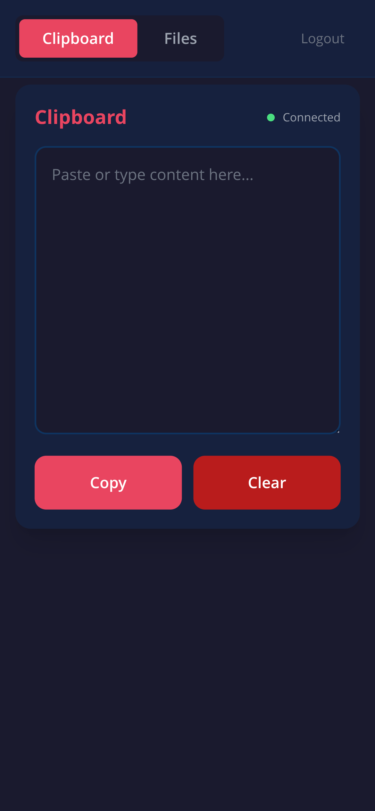
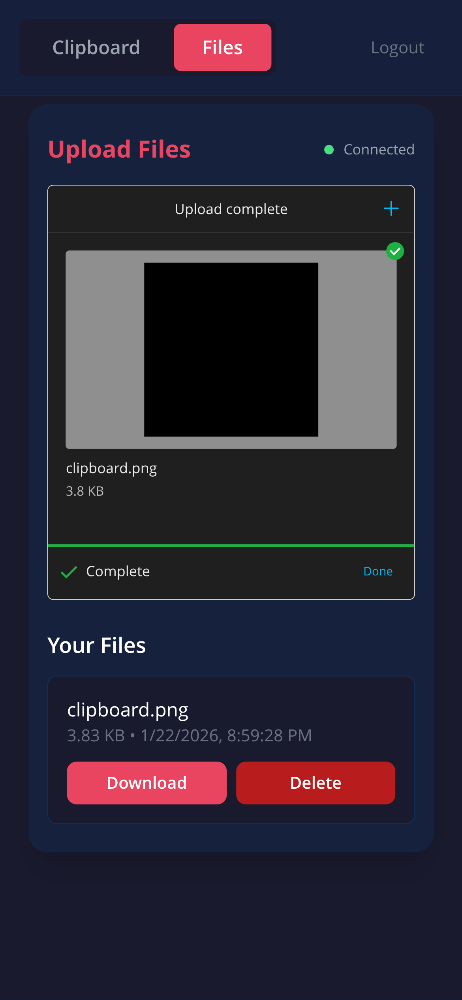

# Clipboard

Shared clipboard service with WebSocket sync for real-time clipboard sharing across devices.

## Features

- 📋 Real-time clipboard synchronization via WebSocket
- 📁 File upload and sharing with resumable uploads (tusd)
- 🔐 Password-based authentication
- 💾 Persistent auth token storage with MongoDB (optional) or in-memory
- 🚀 Easy deployment with Helm
- 💩 Vibe coded AI slop

## Screenshots

<div align="center">
  
  
</div>

## CLI

A `cb` command-line client is included for interacting with a clipboard server from the terminal.

#### Install

```bash
go install github.com/ConnorsApps/clipboard/cmd/cb@latest
```

This drops a `cb` binary in `$(go env GOPATH)/bin` — make sure that's on your `PATH`.

#### Log in

```bash
cb login --server https://clipboard.example.com
# (you'll be prompted for the password)
```

Credentials are saved to `~/.config/clipboard-cli/config.yaml` (honors `XDG_CONFIG_HOME`).

#### Commands

| Command | What it does |
| --- | --- |
| `cb get` | Print clipboard contents to stdout. Pipe-friendly. |
| `cb set [text]` | Set clipboard from args or stdin. e.g. `echo hi \| cb set` |
| `cb clear` | Empty the clipboard. |
| `cb live` | Interactive TUI viewer + editor with live WebSocket sync. `e` to edit, `ctrl+s` to send, `q` to quit. |
| `cb files list` | List uploaded files. |
| `cb files upload <path>` | Upload a file (resumable via tusd). |
| `cb files download [id]` | Download by id, or pick interactively. Streams to stdout when piped. |
| `cb files delete <id>` | Delete a file. |
| `cb logout` | Forget saved credentials. |

#### Zsh completion

```bash
# Enable now and persist for future shells
source <(cb completion zsh) && echo 'source <(cb completion zsh)' >> ~/.zshrc
```

Bash is supported too: `cb completion bash`.

## Deployment

#### Add the Helm Repository

```bash
helm repo add clipboard https://connorsapps.github.io/clipboard
helm repo update
```

#### Install the Chart

```bash
# Create a values file with your configuration
cat > my-values.yaml <<EOF
config:
  passwords: "your-secure-password,my-other-users-password"
  mongodbUri: "mongodb://your-mongo-uri"  # Optional, leave empty for in-memory
persistence:
  storageClass: "your-storage-class"
  size: 10Gi
EOF

# Install the chart
helm upgrade --install clipboard clipboard/clipboard -n clipboard --create-namespace -f my-values.yaml
```

The chart is plain Helm templates (Deployment, Service, Secret, PVC). See [values.yaml](charts/clipboard/values.yaml) for every option. New chart versions are published by GitHub Actions when `version` in [Chart.yaml](charts/clipboard/Chart.yaml) is bumped on `main`.

#### Configuration

Key configuration options:

- `config.passwords`: Password(s) for authentication (required unless `existingSecret` is set; without one the app would fall back to `1234`). Separate multiple users' passwords with commas. Each user is distinguished by their password.
- `config.mongodbUri`: MongoDB connection string (optional). If not set, the app uses an in-memory token store.
- `config.tokenExpiry`: How long MongoDB auth tokens last before auto-expiring. Accepts a number of days (`10d`, `30d`, etc.) or `never`. Defaults to `30d`.
- `existingSecret`: Name of a Secret you manage, with the keys `CLIPBOARD_PASSWORDS` and optionally `MONGODB_URI`, instead of having the chart create one.
- `persistence.*`: The PVC for uploaded files (mounted at `/data`). Use `persistence.existingClaim` to reuse a PVC, or `persistence.enabled: false` for an `emptyDir`.
- `httpRoute.*`: Gateway API HTTPRoute, disabled by default.

#### Expose with a Gateway API HTTPRoute

```yaml
httpRoute:
  enabled: true
  parentRef:
    name: my-gateway
    namespace: gateway-system  # omit if the Gateway is in the release namespace
    sectionName: https         # optional listener name
  hostnames:
    - clipboard.example.com
```

The app uses long-lived WebSockets (`/ws`) and large uploads (`/api/uploads`), so make sure your Gateway's request timeouts allow both.

#### Upgrading from chart 1.x

Chart 2.0 drops the [HULL](https://github.com/vidispine/hull) dependency for plain templates, and the chart is now published to a new repo URL:

```bash
helm repo remove clipboard
helm repo add clipboard https://connorsapps.github.io/clipboard
```

Values and object names changed, so upgrading in place needs two things:

1. **Keep your uploaded files.** The PVC has a new name, and an upgrade would create an empty one. Point the chart at the existing PVC (HULL named it `<release>-clipboard-files`; confirm with `kubectl get pvc`):

   ```yaml
   persistence:
     existingClaim: my-release-clipboard-files
   ```

2. **Move your values.** A leftover `hull:` block makes the chart fail instead of being silently ignored.

   | 1.x (under `hull.objects`) | 2.x |
   |---|---|
   | `secret.clipboard.data.CLIPBOARD_PASSWORDS.inline` | `config.passwords` |
   | `secret.clipboard.data.MONGODB_URI.inline` | `config.mongodbUri` |
   | `secret.clipboard.data.FILES_DIR` / `PORT` / `IS_LOCAL` | removed (set by the chart) |
   | `persistentvolumeclaim.files.storageClassName` | `persistence.storageClass` |
   | `persistentvolumeclaim.files.resources.requests.storage` | `persistence.size` |
   | `deployment.main.pod.containers.main.image` | `image.repository`, `image.tag` |
   | `deployment.main.pod.containers.main.resources` | `resources` |
   | `service.main.type` | `service.type` |

The chart no longer creates a ServiceAccount, Role or RoleBinding (the app never talks to the Kubernetes API).

#### Authentication and token storage

- **In-memory store** (when `config.mongodbUri` is not set): Auth tokens are kept only in process memory. **All users must log in again after each server restart** (e.g. deploy or pod restart). Use this for single-instance or dev only.
- **MongoDB store**: Set `config.mongodbUri` for persistent tokens so users stay logged in across restarts. Token expiry is controlled by `config.tokenExpiry` (default `30d`). Set to `never` to disable expiry.
- Transient token-store errors (e.g. MongoDB timeouts) are returned as 503; the frontend retries and does not clear the token, so users are not logged out by brief backend issues.
