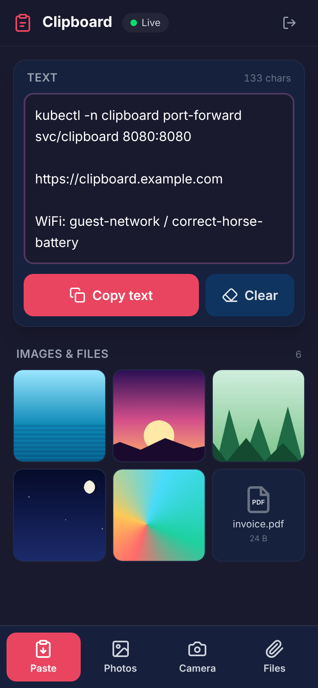
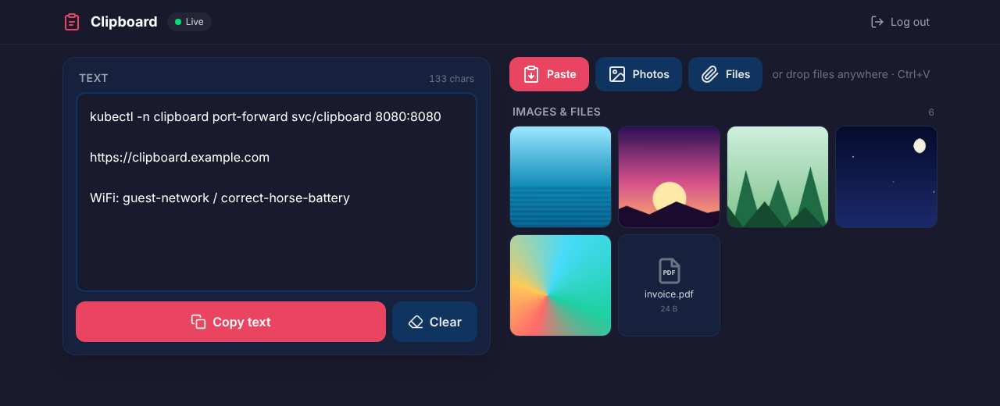

# Clipboard

Shared clipboard for text, images and files across your devices, synced live.

- Real-time text sync over WebSocket
- Image and file sharing with resumable uploads (tus)
- Password login; tokens in memory or MongoDB
- `cb` CLI and Helm chart
- 💩 Vibe coded AI slop

<div align="center">
  
  
</div>

## CLI

```bash
go install github.com/ConnorsApps/clipboard/cmd/cb@latest
cb login --server https://clipboard.example.com   # prompts for the password
```

| Command | |
| --- | --- |
| `cb get` | Print the clipboard (pipe-friendly) |
| `cb set [text]` | Set from args or stdin: `echo hi \| cb set` |
| `cb clear` | Empty the clipboard |
| `cb live` | Live TUI: `e` edit, `ctrl+s` send, `c` copy, `q` quit |
| `cb files list` | List files |
| `cb files upload <path>` | Upload (resumable) |
| `cb files download [id]` | Download; picks interactively without an id, streams to stdout when piped |
| `cb files clear` | Delete all files |
| `cb logout` | Forget credentials |

Config lives in `~/.config/clipboard-cli/config.yaml`. Completion: `source <(cb completion zsh)` (or `bash`).

## Deploy

```bash
helm repo add clipboard https://connorsapps.github.io/clipboard
helm upgrade --install clipboard clipboard/clipboard -n clipboard --create-namespace \
  --set config.passwords='change-me'
```

All options: [values.yaml](charts/clipboard/values.yaml).

| Value | |
| --- | --- |
| `config.passwords` | Comma-separated; each password is its own user. Required unless `existingSecret` is set |
| `config.mongodbUri` | Keeps logins across restarts. Empty = in-memory, so everyone logs in again after a restart |
| `config.tokenExpiry` | `10d`, `never`, ... (default `30d`; MongoDB only) |
| `existingSecret` | Secret with `CLIPBOARD_PASSWORDS` and optional `MONGODB_URI` |
| `persistence.*` | Files PVC mounted at `/data`; `existingClaim` to reuse one, `enabled: false` for `emptyDir` |
| `httpRoute.*` | Gateway API route, off by default |

```yaml
httpRoute:
  enabled: true
  parentRef: {name: my-gateway, namespace: gateway-system, sectionName: https}
  hostnames: [clipboard.example.com]
```

The Gateway's timeouts must allow long-lived WebSockets (`/ws`) and large uploads.
